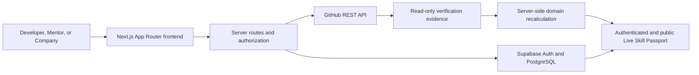

# DevStack — Project Pitch

## A. Project identity

**Product name:** DevStack

**Tagline:** Turn skills into verifiable evidence.

**Elevator pitch:** DevStack turns public repositories, practical work,
rubric reviews, and skill scores into a living developer passport.

**Product category:** Evidence-based developer assessment and professional
credential platform.

**Target audience:** Developers building demonstrable experience, mentors
reviewing practical work, and companies evaluating candidates.

## B. The problem

Traditional CVs describe experience, but they do not reliably prove what a
developer can build. Certificates may confirm participation without showing
real engineering decisions. Recruiters still struggle to compare candidates
across projects and experience levels. Developers need a portable record that
connects work, evidence, and human evaluation.

## C. The solution

DevStack combines:

- Practical challenges with structured requirements and rubrics.
- Public GitHub repository evidence.
- Read-only CI, README, activity, language, metadata, and workflow checks.
- Peer and mentor review foundations.
- A Live Skill Passport and six-domain radar.
- Public, shareable profile URLs.

GitHub evidence is an observation, not a human rubric decision. Review approval
and verified challenge XP remain separate server-authorized outcomes.

## D. The main wow factor

The Live Skill Passport is a connected evidence loop:

1. A developer chooses a practical challenge.
2. The developer submits a public repository owned by the linked GitHub account.
3. DevStack retrieves timestamped repository evidence through GitHub REST.
4. Reviewers can submit an authorized rubric evaluation.
5. The server recalculates the relevant skill-domain score.
6. The authenticated and public passport reflects available evidence.

The system does not claim AI grading, blockchain authorship, or cryptographic
proof. The snapshot fingerprint implementation identifies evidence changes
without claiming authorship or blockchain verification.

## E. Three user experiences

### Developer

- Developer overview.
- Skill Passport and radar.
- 120-challenge Proofs library.
- Challenge detail and repository submission.
- Repository evidence history.
- Peer/mentor review visibility.

### Mentor

- Mentor overview.
- Mentor profile and directory view.
- Review queue and review submission.
- Mentor workspace navigation.
- Voting remains a labeled Phase 4 placeholder.

### Company

- Company overview.
- Public passport search.
- Public project discovery.
- Workspace authorization and navigation.
- Recruitment/voting workflows remain deferred.

## F. Challenge platform

The challenge platform source defines exactly 120 published platform
challenges:

| Domain | Beginner | Intermediate | Advanced | Total |
| --- | ---: | ---: | ---: | ---: |
| Frontend | 7 | 7 | 6 | 20 |
| Backend | 7 | 7 | 6 | 20 |
| Data | 7 | 7 | 6 | 20 |
| DevOps | 7 | 6 | 7 | 20 |
| System Design | 6 | 7 | 7 | 20 |
| Product | 6 | 6 | 8 | 20 |
| Total | 40 | 40 | 40 | 120 |

The catalog includes search, domain/difficulty/status/sort filters, pagination,
challenge detail pages, XP values, explicit rubrics, and repository
submission/history.

## G. Technology stack

- Next.js App Router: routing, Server Components, layouts, and route handlers.
- TypeScript: strict application contracts.
- Tailwind CSS: responsive visual implementation.
- Shadcn/Radix UI: accessible primitives and application components.
- Recharts: passport radar and evidence visualization.
- Supabase Auth: sessions, OAuth, and profile identity.
- PostgreSQL/RLS: authorization and persisted data.
- GitHub OAuth: account identity and GitHub connectivity.
- GitHub REST API: safe read-only repository evidence.
- Node test runner/tsx: local fixture and static regression tests.

## H. System architecture

## I. Five-minute live demo script

1. Open `/` and explain why traditional CV evidence is weak.
2. Open `/signup` or `/login`, using an authorized staging account.
3. Open `/app/proofs` and demonstrate search and combined filters.
4. Open a practical challenge.
5. Start the challenge and show in-progress state.
6. Submit a public repository owned by the linked GitHub account.
7. Sync repository evidence and explain passed, failed, unknown, and pending
   states.
8. Open `/app/passport` and show repository, challenge, review, and radar states.
9. If authorized, switch to a mentor or company workspace.
10. Close with the recruiter and candidate value proposition.

Fallback: use the landing page, challenge catalog, and public passport seed
only if GitHub, staging authentication, or Supabase data is unavailable.

## J. Hackathon pitch

### 30-second pitch

DevStack turns a developer's public work into a shareable evidence-first
passport. It combines practical challenges, read-only GitHub evidence,
server-side scoring, and mentor or peer review.

### 60-second pitch

Traditional CVs and certificates do not prove practical engineering ability.
DevStack gives developers a challenge library and public GitHub evidence trail,
then combines available evidence with authorized human review and recalculated
domain scores. Recruiters can inspect the evidence rather than relying only
on claims. GitHub data never executes repository code, and pending evidence
does not become approval or verified XP.

### Three-minute outline

1. Introduce the resume/evidence problem.
2. Demonstrate the challenge catalog.
3. Submit repository evidence.
4. Distinguish repository checks from human approval.
5. Show the Live Skill Passport.
6. Explain mentor/company workspaces and staged roadmap.
7. Close on portable, honest, verifiable developer evidence.

### Likely judge questions

**Is GitHub evidence enough to validate skill?** No. DevStack preserves
timestamped repository evidence and separates it from authorized rubric review.

**Can a challenge award XP automatically?** No. Repository sync is not approval
and no ordinary client can set verified score or awarded XP.

**Does DevStack execute submitted code?** No. It uses GitHub REST metadata and
workflow results only.

**Are the public passport and review systems complete?** The public passport,
scoring UI, and review foundations are implemented; mentor voting and company
recruitment workflows remain partial or deferred.

**Is the 120-challenge catalog live?** It is defined in migration source and
covered by tests, but it is not reported live until migration and seed state
have been confirmed against an owned staging database.

### Three differentiators

1. Evidence is separated from human approval.
2. Unknown GitHub evidence is not silently treated as success.
3. A shareable passport combines repositories, challenges, reviews, and scores.

### Closing

DevStack makes engineering ability visible through work, evidence, review,
and transparent limitations.

## K. Competitive differentiation

- Unlike traditional CVs, DevStack ties claims to inspectable artifacts.
- Unlike generic challenge platforms, it preserves a GitHub evidence trail and
  public passport.
- Unlike certificate portfolios, it includes practical rubrics and
  server-controlled evidence updates.
- Unlike GitHub alone, it organizes repositories into domains, challenges,
  review outcomes, and skill scores.

No unsupported competitive market claims are made.

## L. Roadmap

### Completed

- Next.js foundation and dark SaaS UI with dark/light/system theme switching.
- Supabase authentication and workspace foundations.
- Pitch-aligned public landing page redesign with live demo passport link and 120-challenge matrix.
- Mentor approval lifecycle with pending status screen (`/mentor/pending`) and admin verification.
- Immediate Company onboarding with read-only Mentor Discovery (`/company/[slug]/mentors`).
- Developer workspace cleanup focusing on Overview, Passport, Proofs, Projects.
- Protected primary account type with secondary workspaces limited to independently authorized memberships.
- Mobile drawer navigation and responsive layout verification across 320px–1440px viewports.
- 120-challenge migration/catalog source.
- Challenge browsing/detail/progress/submission flows.
- Read-only GitHub repository evidence.
- Review API and score recalculation foundations.
- Authenticated/public passport implementations.
- Public and private profile views.

### Partially implemented

- Mentor review queue and review history.
- Company passport search and public project view.
- Challenge verification-to-review workflow.
- Live staging and RLS validation.

### Planned

- Complete mentor voting and review workflows.
- Company recruitment and candidate discovery.
- External API key management.
- Improved repository deliverable checks.
- Production observability and operational hardening.
- Public developer integrations.

## M. Demo readiness checklist

- [ ] Apply migration sequence to controlled staging database.
- [ ] Apply migration 013 and confirm 120 live published records.
- [ ] Create authorized developer, mentor, and company test accounts.
- [ ] Seed deterministic demo auth users and fixtures.
- [ ] Configure GitHub OAuth and callback URLs.
- [ ] Configure a server-only read-only GitHub token if needed.
- [ ] Verify public/private passport visibility.
- [ ] Verify mentor and company authorization states.
- [ ] Prepare stable internet and GitHub access.
- [ ] Capture landing, challenge, evidence, and passport screenshots.
- [ ] Prepare a fallback demo with already-seeded staging data.
- [ ] Assign presenter, demo operator, and fallback narrator roles.
- [ ] Rehearse a five-minute sequence and a 60-second fallback.

### Phase 4.0 onboarding walkthrough

Open the selected account's workspace after signup. Register as a Mentor to see
a basic profile and verification status before any reviewer capabilities are
granted. Register as a Company to open its dashboard, look up public passports,
and switch to Mentor Discovery for approved public profiles. The account type
cannot be changed through registration, and additional role access must already
be independently authorized.
